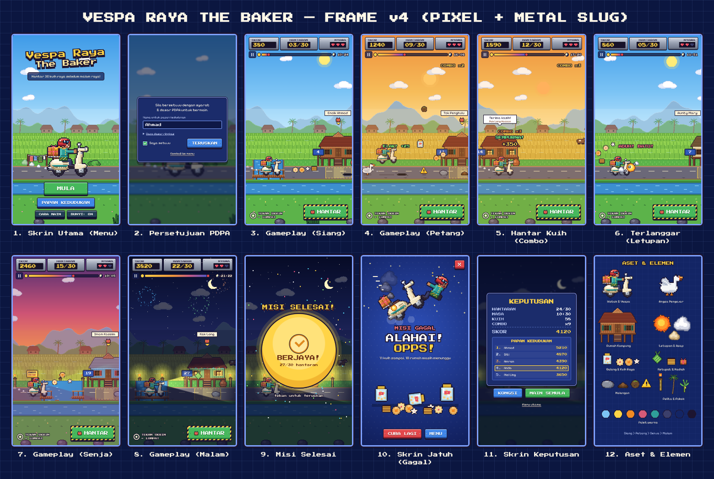

# Vespa Raya The Baker

Permainan runner pixel art 2D dengan sentuhan arked (shading tebal, letupan, asap, serpihan, HUD logam berivet): bawa vespa, hantar kuih raya ke 30 rumah kampung dari siang hingga malam raya.
Semua grafik dilukis dengan kod (tiada fail imej), muzik & bunyi disintesis dengan WebAudio.



## Cara jalankan

Buka `index.html` dalam pelayar, atau hidangkan folder ini:

```bash
npx serve vespa-raya
```

## Kawalan

| Tindakan | Sentuh | Papan kekunci |
| --- | --- | --- |
| Lompat (tekan lama = lebih tinggi) | Tekan mana-mana bahagian skrin | Space / ↑ |
| Hantar kuih | Butang **HANTAR** | Enter / → |
| Rehat | Butang ‖ | P / Esc |

## Muzik (gubahan asal)

| Keadaan | Rentak & alat |
| --- | --- |
| Menu, keputusan | Gamelan Melayu: saron, keromong, gambang, kenong, gong agung, gendang ibu/anak |
| Siang → petang | Joget raya 6/8 (hemiola): biola, akordion, gendang Melayu, rebana, kompang |
| Senja → malam | Zapin: gambus, marwas, dok, kompang + warna gamelan, lebih dramatik |
| Nyawa tinggal 1 | Versi tegang: tremolo gambus, gendang laju, degupan jantung |
| ALAHAI OPPS | Lagu "pening": nada beralun, wisel jatuh, burung bercicip |

## Aliran skrin

Menu → PDPA (nama + setuju, sekali sahaja) → Kiraan 3-2-1 → Siang → Petang → Senja → Malam → Selesai → Keputusan.
Nyawa habis → skrin "ALAHAI! OPPS!".

## Pratonton setiap frame

Tambah `?frame=<nama>` pada URL untuk paparan statik satu skrin:
`menu`, `pdpa`, `caramain`, `siang`, `petang`, `hantar`, `langgar`, `senja`, `malam`, `banner`, `zon`, `jatuh`, `keputusan`, `aset`.

## Di mana nak ubah

| Nak ubah | Lokasi dalam `game.js` |
| --- | --- |
| Jumlah rumah, kelajuan, lompatan | `TOTAL`, `SPEED_MIN/MAX`, `JUMP_V/GRAV` (atas fail) |
| Warna sprite | `PAL`, `MS` (tona tambahan), `HOUSE_VARIANTS` |
| Nama penerima kuih | `NAMES` |
| Nama & ayat fasa (Siang/Petang/...) | `PHASES` |
| Warna langit ikut masa | `SKY` |
| Teks bila terlanggar | `HURT_TEXT` |
| Watak, vespa, angsa, rumah | `drawRider`, `drawVespa`, `drawGoose`, `drawHouse` |
| Letupan, asap, debu, serpihan | `drawExplo`, `drawPuff`, `fx()`, `debris()`, `hurt` |
| Muzik (melodi, rentak, tempo) | `SONG_MENU`, `SONG_JOGET`, `SONG_PLAY`, `KOMPANG_*`, `Sfx.step*` |
| Susunan halangan setiap fasa | `fillHazards` (pemberat `weights`) |
| Markah hantaran / combo | `deliver`, `comboMult` |
| Skrin jatuh | `drawCrashScene` |

Teks butang & panel ada dalam `index.html`; gaya dalam `style.css`.
Papan kedudukan disimpan dalam `localStorage` pelayar pemain.
